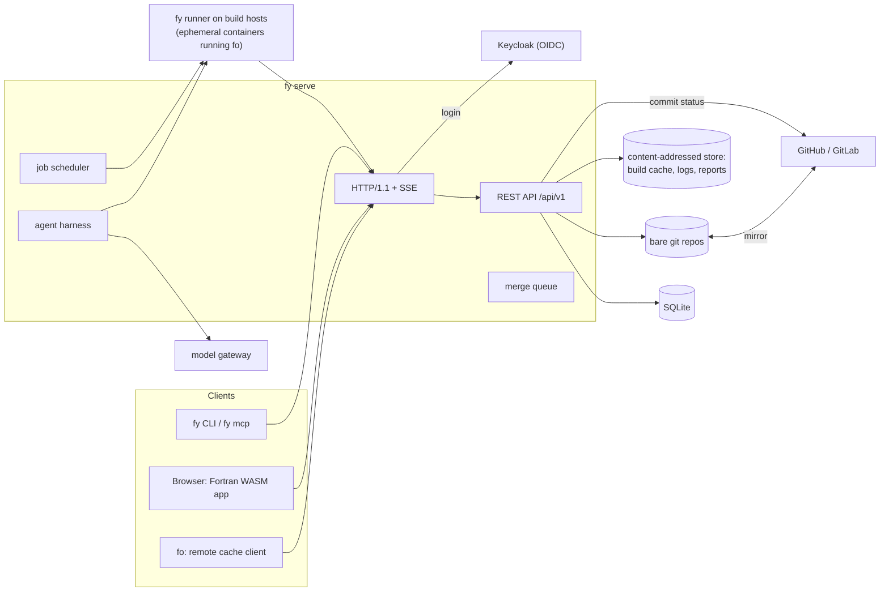

# fortyard design

fortyard is a self-hosted forge for Fortran projects. It covers git hosting,
continuous integration, code review, a merge queue, issues, a shared binary
build cache, and AI agents that write and review code. It is written in modern
Fortran wherever that is sensible. One binary, `fy`, is server, build runner,
command-line client and MCP server (Model Context Protocol, the standard
interface through which coding agents call tools).

This document fixes the goals, the architecture and the order of delivery for
the first version (MVP). Internal module layouts are open and change as the code
grows; the decisions recorded under [Decisions](#decisions) are binding until
they are explicitly revised.

## Goals

- **Independence from hosted forges.** CI does not queue behind a shared hosted
  service, and repositories in primary or failover mode (see
  [Mirroring](#mirroring-and-the-overlay-mode)) keep accepting pushes and merges
  during GitHub or GitLab outages.
- **Fortran-native CI and review.** fortyard understands Fortran projects
  through [fo](https://github.com/lazy-fortran/fo), the lazy-fortran build and
  test driver for fpm and CMake projects (`fo verify` runs static checks, build,
  tests, lint and format check; `fo check --json` reports the result as JSON;
  `fo changed` lists changed modules and the tests depending on them; `fo cover`
  produces a coverage report). This gives module graphs, affected tests, module
  interface changes, coverage and compiler matrices without hand-written
  pipeline files.
- **AI as a first-class participant.** Agents implement issues, review pull
  requests and address feedback through the same interfaces and permissions as
  people. fortyard, not the agent, performs every push and merge.
- **Seamless local work.** Everything the web interface can do, the `fy`
  command line and its MCP server can do too, with API tokens. What the server
  checks, `fy` can check locally first.
- **Faster builds everywhere.** CI publishes fo's content-addressed build
  results to a shared cache that developers and runners read.
- **Modern Fortran.** Server, runner, client, agent harness and web interface
  are Fortran. C libraries are used through `bind(C)` where reimplementing them
  would be unsafe or wasteful (TLS, SQLite); external programs (`git`,
  `fo`, a container runtime) are called as subprocesses.

Non-goals for the MVP: hosting large data, replacing git's storage format,
federation between forges, public sign-up.

## Decisions

| Topic | Decision |
|---|---|
| Name | fortyard; binary `fy` |
| Deployment | Single-node monolith. The MVP is reachable only over a WireGuard network; a later deployment sits behind an HTTPS reverse proxy under a path prefix such as `/yard` |
| Git source of truth | Overlay first: GitHub stays primary, fortyard mirrors, runs CI and review and reports status back. Repositories move to fortyard-primary one at a time |
| Repositories in scope | Code repositories now on GitHub, starting with [fx](https://github.com/lazy-fortran/fx) (the dependency-free Fortran infrastructure library under fo), fo and fortyard itself. Data repositories stay on the organization's GitLab with its Git LFS storage and are not migrated |
| Version control model | Git first: git storage, wire protocol and plain git workflows; changes are identified by a `Change-Id` trailer |
| Large files | No fortyard-specific large-file mechanism. A size limit on receive keeps large objects out of history. Large data stays in Git LFS on the existing GitLab or in a DOI archive |
| Identity | OpenID Connect against the organization's existing Keycloak realm. Authentication only: fortyard decides authorization, deny by default |
| HTTPS client | libcurl through `bind(C)` |
| Database | SQLite through `bind(C)`, in write-ahead-log mode so readers never block the writer |
| AI models | Local models behind an OpenAI-compatible gateway by default; external models per repository only where its settings allow it and with credentials that permit unattended use |
| Workflow | Merge first, review later as a hard rule, with review before merge only for irreversible effects; agents triage, review, garden issues and explore; everything auditable (see [Workflow](doc/workflow.md)) |
| Namespaces | Nested groups and subgroups as on GitLab, plus a personal namespace per account; URLs `/GROUP/SUB/REPO` with pages after `/-/`; old paths redirect after moves |
| GitHub | Code, tags and releases are pushed to GitHub mirrors; issues are synchronised both ways; GitHub pull requests are never merged automatically, only ingested by a person after checking them. Self-hosted GitHub runners are retired once fortyard is fully up |
| Agent harness | Written in Fortran inside fortyard |
| Web interface | Target: full browser application in Fortran compiled to WebAssembly; server-rendered HTML until that exists (see [Web interface](#web-interface)) |
| Runners | Container hosts run all builds and tests; the server host runs none |
| Backups | restic to a separate filesystem |
| Implementation languages | Fortran; POSIX shell for scripts; JavaScript only where the browser requires it (the WebAssembly loader). No Python anywhere, including tests and tooling |
| Development | Everything runs and is tested on one development machine first, with a complete local environment and no production access (see [Development environment](#development-environment)) |

## Architecture



### Server process

`fy serve` is one program running as a supervisor and its worker processes:

- **HTTP.** HTTP/1.1 written in Fortran directly against POSIX sockets through
  `bind(C)`, with no C source files. Live updates (CI logs, agent
  traces, review events) use server-sent events. fortyard itself never speaks
  TLS: in the MVP, WireGuard encrypts the traffic; later, the reverse proxy
  terminates HTTPS.
- **Concurrency.** The supervisor forks a few worker processes that share the
  listening socket. In each worker, OpenMP threads run their own accept loops,
  each with its own SQLite connection, so a slow request or a long-lived event
  stream holds one thread. A worker that dies, for example on a Fortran runtime
  error, loses only its own requests and is replaced; threads alone could not
  isolate such a failure. Long work (git operations, mirroring, agent turns)
  runs in child processes. SQLite in WAL mode has one writer at a time.
- **Storage.** Under one data directory: `fortyard.db`, `repos/<owner>/<name>.git`
  (bare, kept packed by periodic geometric repacking so there are few large
  files), and `cas/sha256/` for build-cache objects, logs, JUnit and coverage
  reports. Small objects live on the server's local disk, never on a network
  or distributed filesystem, where many small files are slow and strain the
  metadata servers.

### Git

fortyard stores repositories in git's format and speaks git's smart HTTP and SSH
protocols, by calling `git http-backend`, `git receive-pack` and
`git upload-pack`. Git is not reimplemented. This keeps every git client,
GitHub and GitLab mirroring, fo and the runners working unchanged. Plain git is
the workflow fortyard is designed for; other clients that speak git work too.

- **Change IDs.** Every change has a stable ID that survives amend and rebase:
  `fy` installs a commit-message hook that adds a `Change-Id` trailer, as Gerrit
  does, which amend and rebase preserve. Commits that arrive without one get an
  ID on first push and are matched to later versions by branch name.
- **Changes are what is reviewed** (fortyard's pull requests, see
  [Workflow](doc/workflow.md#changes)). A force-push creates a new version of
  the same change. Review comments are anchored to change, path and line and
  are carried across versions; each version shows its difference from the
  previous one (interdiff). A stack is a sequence of changes, each with its own
  review.
- **Server-side history work uses git**: squashing, rebasing stacks, merge-queue
  candidates and conflict detection run through `git` subprocesses.
- **Agents work in their own clone** in a sandbox; fortyard performs every push.

Repository checks that run as pre-commit hooks on a developer's machine (format,
repository hygiene) run again when a change lands, so nothing that skipped the
hooks reaches `main`. In overlay mode, pushes go to the upstream forge directly,
so there the upstream's own checks and fortyard's CI apply instead.

**History rewriting.** Rewriting unpushed work is normal. Pull-request stacks
accept force-pushes. Protected branches (`main`, release branches) refuse
non-fast-forward updates. An administrator-only purge, for a leaked secret or
an object that slipped past the size limit, rewrites history with
`git filter-repo`, keeps the old-to-new commit map so old hashes still resolve
in links and records, and force-pushes the mirrors. Copies cloned before the
purge cannot be recalled, so leaked secrets are always rotated.

**Size limit on receive.** A push is refused if it introduces any blob above a
per-repository limit (a few MB by default) outside explicitly allowed paths.
`fy push` applies the same rule before sending. In fortyard-primary
repositories, large objects therefore enter history only through allowed paths,
and mirrors stay within hosted-forge limits. In overlay mode the upstream
forge's own limits apply.

### Mirroring and the overlay mode

Each repository has a mode:

- **Overlay** (MVP default): the upstream forge is primary. fortyard fetches it
  on a short polling interval, since webhooks cannot reach a server inside a
  WireGuard network. It runs CI on new heads and pull requests and posts commit
  statuses back through the forge API, so fortyard can be a required check
  there.
- **Primary:** fortyard accepts pushes and merges, then push-mirrors to GitHub
  and GitLab. Mirrors never receive non-fast-forward updates except during a
  purge.
- **Failover:** an administrator can switch an overlay repository to primary
  during an outage. When the upstream returns, fortyard pushes the new history
  if it is a fast-forward and otherwise stops and reports the divergence.

Mirrors of repositories that use Git LFS fetch only the pointer files; runners
fetch LFS objects from the upstream LFS server when a job needs them.

**Order of moving to primary.** fortyard itself is the first primary
repository, as soon as fortyard can accept pushes, run CI on them and
push-mirror to GitHub. It has no outside users, so problems surface on our own
work first. fx and fo follow once native pull requests and the merge queue
work; their GitHub repositories stay public mirrors. The first large code is
MILCA, a plasma multiphysics code of about 240,000 lines of Fortran built with
CMake, with several hundred commits a month; it is the test of whether fortyard
keeps a fast-moving large code verified. Other code repositories follow after
that. A self-hosted forge must not depend on itself
for repair: fortyard's GitHub mirror is always current, any clone can build a
release, and `fy deploy` (see [Releases](#releases-and-deployment)) installs
it without going through fortyard's CI.

### CI

A pipeline is derived from the project, not written as YAML:
everything fo can discover is discovered, everything measurable is learned,
and only what cannot be inferred (runner class, private data, release gates)
is configured (see
[Discovered tests and declared policy](doc/testing-at-scale.md#discovered-tests-and-declared-policy)).

- **Default:** static checks, lint and format check, a build, and the test
  cases the change affects within a time budget, run through fo with
  structured JSON results. All other cases are verified afterwards in the pool
  (see [Testing at scale](doc/testing-at-scale.md)).
- **Configuration:** an `[extra.fortyard]` table in `fpm.toml` (fpm reserves
  `[extra]` for third-party tools), or `fortyard.toml` for CMake projects.
  It selects compilers for a matrix (gfortran, flang, ifx, LFortran), profiles,
  coverage thresholds, the pre-merge time budget, maximum staleness per test
  label and extra commands.
- **Jobs** run on `fy runner` processes on build hosts. A runner long-polls the
  server, claims a job with a lease, runs it in a container holding only a
  job-scoped token, streams the log, uploads JUnit, coverage and cache objects,
  and sends heartbeats. An expired lease returns the job to the queue. Jobs
  from users with write access reuse a persistent build tree; untrusted jobs get
  an ephemeral one.
- **Results** are stored per test case with the hash of the case's inputs:
  verdict (including fo's FLAKY verdict for passes after retries), CPU time,
  peak memory and log excerpt. A trusted pass is reused for every commit with
  the same input hash.
- **Scale.** Pull requests and the merge queue run the cases a change affects,
  up to a time budget; everything else is verified continuously afterwards, and
  regressions are bisected and reported to their authors. This, together with
  memory admission, disk-write limits and performance tracking, is described in
  [Testing at scale](doc/testing-at-scale.md).
- **Coverage** comes from `fo cover`, which calls
  [fortcov](https://github.com/lazy-fortran/fortcov). fortyard stores the
  report per commit and shows coverage of the changed lines in reviews.
- **Local runs.** `fy ci run --local` runs the same job on the developer's
  machine with fo. Its results are shown as local evidence but never satisfy a
  required check.

### Merge queue

Merges into protected branches go through a queue. The queue builds the
candidate result of the target branch plus the queued stacks, runs the
pre-merge tier on it (affected cases within the budget), and fast-forwards the
branch only if it passes. Rules are set
per repository: required checks, and approvals only for the areas reviewed
before merge (see [Workflow](doc/workflow.md#the-merge-queue)). The queue applies only to fortyard-primary repositories;
in overlay mode the merge happens upstream and fortyard provides a required
status.

### fo and fy

fo knows the project; fy knows the forge. Neither duplicates the other.

| | fo (build and test engine) | fy (forge: server, client, runner) |
|---|---|---|
| Knows | modules and their graph, how to build, which tests exist and which a change affects, result keys, formatting, lint | repositories, branches, landings, changes, jobs, people, permissions, schedules, agents |
| Runs | everywhere: developer machine, runner, agent sandbox; works offline | the server; `fy` on clients and runners |
| State | local caches only | the database, the queue, trusted results |

- **fy calls fo as a program through a versioned JSON contract** and never
  parses Fortran or CMake itself: `fo test --plan --json` (cases with key,
  cost, labels and properties, without building), running a given set of cases
  with results (key, verdict, time, memory, metrics), `fo fmt --check`,
  `fo changed --json`. The fo version is part of every result key.
- **fo uses two optional HTTP services of the instance**, the shared build cache
  and the trusted-result lookup ("did this key pass?"), and otherwise knows
  nothing of landings or changes. Without a server it works as before.
- **One login.** `fy login` stores the instance's address and token where fo
  reads them as well.
- **Where and when is fy's, how is fo's.** Scheduling, budgets, sandbox and
  gates belong to fortyard; fo receives "run these cases with these limits" and
  reports what happened.
- **People and agents use both:** fo for the edit loop (`fo watch`,
  `fo test --only-changed`, Gremlin), fy for everything that leaves the machine
  (`fy push`, `fy test BRANCH`, `fy land`, `fy change`). Agents see the same
  split through the two MCP servers.

**Local and remote tests.** Local runs are for speed and are never trusted:
only the landing check (on exactly the commit that becomes `main`) and the pool
decide. Remote results help locally, because fo skips cases whose key already
passed on the instance. `fy test BRANCH` runs the affected cases of a pushed
branch on a runner and streams the results back, so testing needs no local
toolchain and no local CPU. Local pre-commit hooks keep only the fast checks
that the landing repeats (format, repository hygiene).

### Shared build cache

fo already caches compilation results by content: the key is a SHA-256 over
source, compiler identity, flags and the interfaces of dependency modules. The
shared cache adds a remote tier:

- `GET`, `HEAD` and `PUT /cache/v1/<namespace>/<key>`; fo looks up the local
  store first, then the shared namespace, then the user's own namespace.
- **Trust.** Only CI runners on protected branches and the merge queue write the
  shared namespace; everyone reads it. Users write only their private
  namespace. Downloaded objects are verified against their content hash.
- **Hit rates** depend on identical compiler identities, so runners and
  developers benefit most from the same pinned toolchain versions.
- The cache holds only regenerable build products and is pruned by size and age.

fo stays a build tool: it gains only the remote cache client. Everything else
(CI, scheduling, agents) belongs to fortyard.

### Code review

Reviews show the stack, the revision being reviewed and its interdiff, with
Fortran-aware information next to the diff:

- syntax highlighting from the [fortfront](https://github.com/lazy-fortran/fortfront)
  lexer;
- module interfaces that changed, so API changes are visible even when the diff
  looks local;
- affected tests and their results;
- coverage of changed lines;
- lint findings introduced by the change.

Changes land first and are reviewed afterwards; review states, the human review
queue, flagging and the review ledger are described in
[Workflow](doc/workflow.md#review). Human and agent reviews use the same
objects.

### Issues

Issues have title, Markdown body, labels, assignees, milestones, links to
changes, and a closing reference from landed changes. Issues and changes share
one number sequence per repository. Agents triage them with three separate
priorities and keep the list current; issues of repositories with a GitHub
mirror are synchronised both ways (see [Workflow](doc/workflow.md)).

### AI agents

The roles of agents in the workflow (triage, review, issue gardening,
exploration, later implementation), their sandbox, settings per group and
repository, and how their quality is measured are described in
[Workflow](doc/workflow.md#agents). This section describes the harness.

The agent harness is written in Fortran and runs inside fortyard. It drives
local models through an OpenAI-compatible chat API over libcurl.

Task kinds:

- `implement` an issue as a new stack and open a pull request;
- `review` a pull request at one of three depths: the diff only; the diff with
  surrounding code and callers; or additionally building and testing the
  changed path;
- `address` review feedback on an existing stack;
- `watch`: alternate review and address until approval or a pass limit;
- `fix-regression`: repair a regression that fortyard attributed to a change
  already merged, as a new stack.

Rules:

- The agent has one tool: a shell inside an ephemeral sandbox container with a
  clone of the repository. It never receives forge credentials.
- The only publishable output is an explicit final submission. Reasoning, tool
  input and tool output go to a redacted trace and never become a review body.
- fortyard performs every commit, push and pull-request operation. The agent
  never merges.
- Runs have a budget in tokens and steps, with part of it reserved for the
  final submission. Nothing the model sees contains durations, so its
  behaviour does not depend on the speed of the machine. Repeated identical commands are suppressed with recovery
  hints.
- When the conversation approaches the model's context limit, the harness
  replaces older turns with a summary of established facts and a list of the
  evidence gathered so far (commands run, results observed), and keeps recent
  turns verbatim. The full trace on disk is never shortened.
- Each checkout reads one repository instruction file from a configurable list
  (default `AGENTS.md`), size-limited and without symlinks.
- Review output is human-readable Markdown. A major finding forces "request
  changes"; empty or non-human output is rejected before publication.

Agents are accounts with scoped tokens. Every agent run is a job with a live
trace in the web interface.

### API, `fy` and MCP

- **REST API** under `/api/v1`, JSON, versioned. A server-sent event stream
  `/api/v1/events` delivers repository, CI, review and agent events.
- **`fy`** finds the repository from the current git checkout:
  `fy login`, `fy whoami`, `fy repo`, `fy push`, `fy pr create|list|checkout|review|merge`,
  `fy issue`, `fy ci status|logs|rerun|run --local`, `fy cache`,
  `fy agent review|implement`, `fy serve`, `fy runner`.
- **`fy mcp`** is an MCP server on standard input and output exposing the same
  operations to coding agents, built on fx's MCP module.
- **Login.** `fy login` uses the OAuth device authorization flow, so it works
  over SSH and from agents. It stores a personal access token.

### Web interface

The browser application is Fortran compiled to WebAssembly with LFortran
(target `wasm32-unknown-emscripten`; Flang cannot yet target WebAssembly),
using
[fortui](https://github.com/lazy-fortran/fortui) with its browser backend: DOM
elements for ordinary controls, a canvas for diffs, graphs and plots. The only
JavaScript is the emscripten loader and two small hosts, one in fortui for the
DOM and events and one in fortyard for HTTP requests. Data types, JSON handling and diff
logic are shared modules compiled with both gfortran (server) and LFortran
(browser).

fortyard drives fortui's browser backend: ordinary controls are DOM elements
placed by fortui's layout, and the application's frame loop yields to the
browser between frames. The page signs in by exchanging a token for an HttpOnly,
SameSite=Strict session cookie, so no script on the page holds a credential.
The server also renders plain HTML for read-only views (repositories, diffs, CI
logs), which gives every object a stable permalink and works without
JavaScript.

### Identity and authorization

- **Authentication** is OpenID Connect against the organization's Keycloak realm. The
  fortyard client can require a Keycloak group, so only intended users complete
  a login.
- **Accounts** are keyed on the token's subject identifier (`sub`), never on the
  email address. The first login creates an inactive account; an administrator
  or an invitation activates it.
- **Authorization** is fortyard's own. Repositories live in nested groups
  (subgroups to any reasonable depth) or in a personal namespace per account.
  Roles are read, write, maintain and own; a member's effective role is the
  highest on the path from the repository up to the top group, so a subgroup
  can grant more but never less. Groups are private (members only) or internal
  (everyone signed in). Moving or renaming records a redirect from the old
  path, for the web and for git URLs.
- **Tokens** are scoped (for example `repo:read`, `repo:write`, `ci:run`,
  `cache:write`, `agent:run`), have an expiry, and are stored only as hashes.
  Runner tokens and job tokens are separate kinds.
- **Bootstrap.** `fy serve --init` creates the data directory and prints one
  administrator token, once. It works without Keycloak, so a fresh instance is
  usable before its OIDC client is registered, and it stays as the break-glass
  credential (rotated with `fy token rotate --bootstrap`).
- **Accounts deleted or disabled in Keycloak** lose access: a periodic check
  against Keycloak deactivates the fortyard account and revokes its tokens.
  Their commits, reviews and issues remain, attributed to a deleted account.

### Security

- The MVP listens only on the WireGuard interface.
- Code from contributors without write access and agent sandboxes run only in
  ephemeral containers on runner hosts. The server host never runs builds or
  tests.
- Request parsing in the server is bounds-checked and limited in size.
  Runtime checks stay enabled in the release build of the parsing modules.
- Secrets never enter job environments for changes from contributors without
  write access, such as pull requests from forks of mirrored repositories.
- Shared-cache writes are restricted as described above.

### Backups

- SQLite online backup, the bare repositories and the configuration are backed
  up with [restic](https://restic.net), which deduplicates, encrypts and stores
  data in large pack files, so the backup target may be a network or
  distributed filesystem.
- The build cache is not backed up; it is regenerable.
- A scheduled job restores the latest snapshot into a fresh data directory and
  starts a server on it read-only; a failed restore raises an alert.

### Development environment

Every part of fortyard can be built, run and tested on one development
machine, without production systems or external services:

- `scripts/dev-up.sh` starts a complete instance on the loopback or WireGuard
  address with its own data directory: `fy serve`, one `fy runner` with a small
  memory and CPU budget, and a local Keycloak container for OIDC.
  `scripts/dev-down.sh` stops it; deleting the data directory resets it.
- Upstream forges are simulated: local bare repositories serve as GitHub and
  GitLab remotes, and `fy` has a stub mode that answers the parts of the
  GitHub API fortyard uses (statuses, pull requests), so mirroring and status
  reporting are tested without network access.
- The model gateway is simulated by a stub that replays recorded responses, so
  the agent harness is tested deterministically and without models.
- The test suite of fortyard itself follows
  [Testing at scale](doc/testing-at-scale.md): fast focused tests in the edit
  loop, slower end-to-end tests in the pool.
- All tooling is Fortran or POSIX shell. Nothing in the repository requires
  Python.

### Releases and deployment

fortyard is released continuously from `main`. The goal is a merged change in
production within minutes, with rollback just as fast.

- **Releasable main.** Every merge leaves `main` releasable. Unfinished features
  are merged behind server-side feature flags, off by default.
- **Build once, promote the same artifact.** Each merge to `main` builds the
  release artifacts once: `fy` for Linux x86-64 and macOS arm64, and the
  WebAssembly bundle. Each gets a version `YYYY.MM.DD.N`, the commit hash and a
  SHA-256 checksum, and goes into the server's release store. Promotion moves
  this exact artifact; nothing is rebuilt between channels.
- **Channels.** `edge` takes every merge and deploys automatically to the
  staging instance. `stable` takes an `edge` release that passed its smoke tests
  on staging and ran there for a set time without errors, and deploys
  automatically to production. Either channel can be held or pinned to a
  version.
- **Atomic switch on one node.** Releases live in `releases/<version>/`; a
  `current` symlink is switched atomically and the service restarted. systemd
  socket activation keeps the listening socket open across the restart, so
  requests wait in the kernel queue for the fraction of a second the restart
  takes instead of failing. After the switch a health check and smoke tests
  run; on failure the symlink is switched back and the previous release
  restarted automatically. The last ten releases are kept.
- **Database migrations** are forward-only and split into expand and contract
  steps: a release only adds what it needs, so the previous release still runs
  on the new schema and rollback needs no down-migration. Removing old columns
  or tables happens in a later release. Each migration is preceded by a
  consistent SQLite backup.
- **Runners and clients.** The server announces the runner version it expects;
  runners update themselves between jobs. `fy self-update` fetches the client
  from the server. The API is versioned, so older clients keep working, and the
  server reports the minimum client version it accepts.
- **Who builds releases.** Until fortyard hosts itself, CI on GitHub builds
  them. Afterwards, fortyard's own merge queue builds them and deploys itself.
  `fy deploy <artifact>` with an administrator token installs a release on a
  host directly, independent of fortyard's CI, as the break-glass path.

## Code layout and dependencies

```text
fortyard/
  app/fy.f90             entry point and subcommand dispatch
  src/http/              server, client (libcurl), SSE
  src/db/                SQLite binding, schema, migrations
  src/auth/              OIDC, sessions, tokens
  src/vcs/               git subprocess layer, receive checks, mirroring
  src/ci/                jobs, runner protocol, results, merge queue
  src/cache/             remote cache endpoints
  src/review/            stacks, revisions, comments, Fortran-aware views
  src/issues/
  src/agent/             model client, sandbox control, traces
  src/api/               REST handlers, event stream
  src/cli/               fy client commands
  src/mcp/               MCP tools on top of the client commands
  web/                   WebAssembly application (LFortran)
  test/
```

Dependencies: [fx](https://github.com/lazy-fortran/fx) (JSON, hashing,
content-addressed storage, CLI, MCP, process execution, logging),
[fortfront](https://github.com/lazy-fortran/fortfront) (lexer and module
interfaces), fortui (web interface), and the C libraries libcurl and SQLite.
fx deliberately has no dependencies; a dependency-free HTTP server could live
there, while the libcurl and SQLite bindings stay in fortyard. fortyard builds
and tests with fo.

## Milestones

Each milestone is usable on its own.

**Stage A: MVP inside the WireGuard network**, on one machine, for inspection.

1. **Skeleton.** `fy serve --init` with the bootstrap token; HTTP, SQLite,
   accounts and scoped tokens; OIDC login once the Keycloak client exists;
   `fy login`, `fy whoami`, `fy token create`; `fy mcp` exposing `whoami`;
   restic backup and the scheduled restore test. The release pipeline (`edge`
   channel, atomic switch, rollback, `fy deploy`) exists from this milestone on.
2. **CI overlay.** Mirror fx, fo and fortyard from GitHub; `fy runner` on a
   build host; `fo verify` on new heads and pull requests; logs, JUnit and test
   history; commit statuses posted to GitHub.
3. **fortyard primary for itself.** Pushes to fortyard, CI on them,
   push-mirror to GitHub, and fortyard releasing itself to the `edge` channel.
4. **Server-rendered HTML views** of repositories, commits, diffs, CI logs and
   test history.

Inspection gate: the MVP is reviewed before anything is hosted elsewhere.

**Stage B: hosted instance** on a production host behind the reverse proxy,
with the inspection instance as staging and both release channels active.

5. **Shared build cache** with the trust rules above, and the client in fo.
6. **Coverage** per commit and on changed lines.
7. **Native pull requests and reviews** with stacks, interdiffs and the
   Fortran-aware views; merge queue; failover mode. fx and fo become primary.
8. **Agent harness**: one background agent on a local model for triage and
   review first, then issue gardening and exploration; implementation once a
   second model is available (see [Workflow](doc/workflow.md)).
9. **Issues** with two-way synchronisation for GitHub mirrors, and manual
   ingest of GitHub pull requests.
10. **WebAssembly application** replacing the HTML views step by step.
11. **Further code repositories** move from GitHub to fortyard-primary.

## Open questions

- Credentials for mirroring and status reporting on GitHub: a GitHub App or a
  fine-grained token per organization.
- Where fo's remote cache client gets HTTP from, given that fx has no
  dependencies: a minimal plain-HTTP client in fx for use inside the WireGuard
  network, or an optional libcurl-backed module.
- Whether the WebAssembly application can replace the server-rendered HTML
  views entirely, once fortui's browser backend exists.
- Toolchain pinning for runners and developers, which sets the shared-cache hit
  rate.
