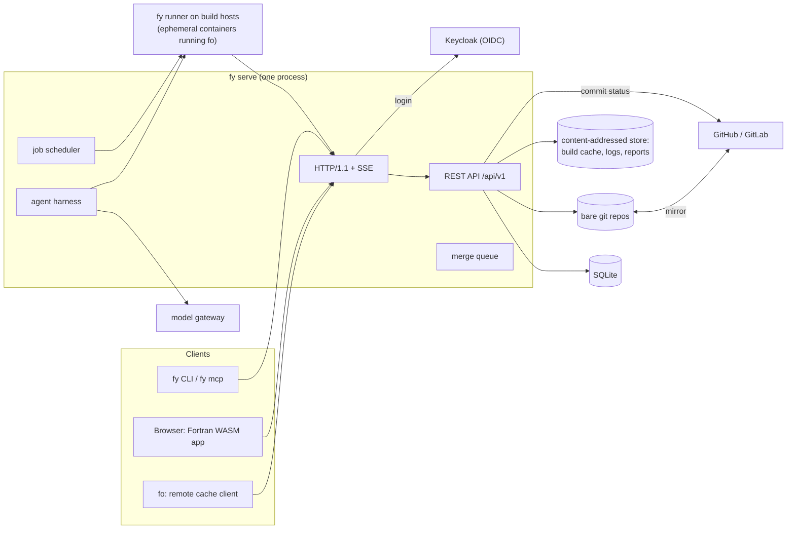

# fortyard design

fortyard is a self-hosted forge for Fortran projects. It covers git hosting,
continuous integration, code review, a merge queue, issues, a shared binary
build cache, and AI agents that write and review code. It is written in modern
Fortran wherever that is sensible. One binary, `fy`, is server, build runner,
command-line client and MCP server (Model Context Protocol, the standard
interface through which coding agents call tools).

This document fixes the goals, the architecture and the order of delivery for
the first version (MVP). Internal module layouts are open and change as the code
grows; the decisions recorded under [Decisions](#decisions) are binding until
they are explicitly revised.

## Goals

- **Independence from hosted forges.** CI does not queue behind a shared hosted
  service, and repositories in primary or failover mode (see
  [Mirroring](#mirroring-and-the-overlay-mode)) keep accepting pushes and merges
  during GitHub or GitLab outages.
- **Fortran-native CI and review.** fortyard understands Fortran projects
  through [fo](https://github.com/lazy-fortran/fo), the lazy-fortran build and
  test driver for fpm and CMake projects (`fo verify` runs static checks, build,
  tests, lint and format check; `fo check --json` reports the result as JSON;
  `fo changed` lists changed modules and the tests depending on them; `fo cover`
  produces a coverage report). This gives module graphs, affected tests, module
  interface changes, coverage and compiler matrices without hand-written
  pipeline files.
- **AI as a first-class participant.** Agents implement issues, review pull
  requests and address feedback through the same interfaces and permissions as
  people. fortyard, not the agent, performs every push and merge.
- **Seamless local work.** Everything the web interface can do, the `fy`
  command line and its MCP server can do too, with API tokens. What the server
  checks, `fy` can check locally first.
- **Faster builds everywhere.** CI publishes fo's content-addressed build
  results to a shared cache that developers and runners read.
- **Modern Fortran.** Server, runner, client, agent harness and web interface
  are Fortran. C libraries are used through `bind(C)` where reimplementing them
  would be unsafe or wasteful (TLS, SQLite); external programs (`git`, `jj`,
  `fo`, a container runtime) are called as subprocesses.

Non-goals for the MVP: hosting large data, replacing git's storage format,
federation between forges, public sign-up.

## Decisions

| Topic | Decision |
|---|---|
| Name | fortyard; binary `fy` |
| Deployment | Single-node monolith. The MVP is reachable only over a WireGuard network; a later deployment sits behind an HTTPS reverse proxy under a path prefix such as `/yard` |
| Git source of truth | Overlay first: GitHub stays primary, fortyard mirrors, runs CI and review and reports status back. Repositories move to fortyard-primary one at a time |
| Repositories in scope | Code repositories now on GitHub, starting with [fx](https://github.com/lazy-fortran/fx) (the dependency-free Fortran infrastructure library under fo), fo and fortyard itself. Data repositories stay on the organization's GitLab with its Git LFS storage and are not migrated |
| Version control model | Git storage format and wire protocol on the server; the data model is change-centric and built for [Jujutsu (`jj`)](https://jj-vcs.github.io/jj/). Plain git clients remain fully supported |
| Large files | No fortyard-specific large-file mechanism. A size limit on receive keeps large objects out of history. Large data stays in Git LFS on the existing GitLab or in a DOI archive |
| Identity | OpenID Connect against the organization's existing Keycloak realm. Authentication only: fortyard decides authorization, deny by default |
| HTTPS client | libcurl through `bind(C)` |
| Database | SQLite through `bind(C)`, in write-ahead-log mode so readers never block the writer |
| AI models | Local models behind an OpenAI-compatible gateway |
| Agent harness | Written in Fortran inside fortyard |
| Web interface | Target: full browser application in Fortran compiled to WebAssembly; server-rendered HTML until that exists (see [Web interface](#web-interface)) |
| Runners | Container hosts for builds; the server host only runs light, fast checks |
| Backups | restic to a separate filesystem |

## Architecture



### Server process

`fy serve` is a single process:

- **HTTP.** HTTP/1.1 written in Fortran directly against POSIX sockets and
  `poll` through `bind(C)`, with no C source files. Live updates (CI logs, agent
  traces, review events) use server-sent events. fortyard itself never speaks
  TLS: in the MVP, WireGuard encrypts the traffic; later, the reverse proxy
  terminates HTTPS.
- **Concurrency.** One event loop accepts and parses requests. Long work (git
  operations, mirroring, agent turns, report rendering) runs in child processes
  or in a small worker pool, so a slow request never blocks the loop. SQLite has
  one serialized writer.
- **Storage.** Under one data directory: `fortyard.db`, `repos/<owner>/<name>.git`
  (bare, kept packed by periodic geometric repacking so there are few large
  files), and `cas/sha256/` for build-cache objects, logs, JUnit and coverage
  reports. Small objects live on the server's local disk, never on a network
  or distributed filesystem, where many small files are slow and strain the
  metadata servers.

### Git and jj

fortyard stores repositories in git's format and speaks git's smart HTTP and SSH
protocols, by calling `git http-backend`, `git receive-pack` and
`git upload-pack`. Git is not reimplemented. This keeps every git client,
GitHub and GitLab mirroring, fo and the runners working unchanged.

The data model is built around changes instead of commits, following jj:

- **Change IDs.** Every change has a stable ID that survives amend and rebase.
  jj writes it into the commit. For plain git, `fy` installs a commit-message
  hook that adds a `Change-Id` trailer, as Gerrit does, which amend and rebase
  preserve. Commits that arrive with neither get an ID on first push and are
  matched to later revisions only heuristically.
- **Pull requests are stacks of changes.** A force-push creates a new revision
  of the same changes. Review comments are anchored to change, path and line and
  are carried across revisions; each revision shows its difference from the
  previous one (interdiff).
- **Server-side history work uses jj.** Rebasing stacks, merge-queue candidates
  and conflict detection run through the `jj` binary with machine-readable
  output templates. The jj version is pinned and its interface covered by tests,
  because jj is still before version 1.0.
- **Agents work in jj workspaces**, which gives them undo for every operation
  and a working copy that cannot be lost.
- **Plain git stays first class.** `fy` recommends jj but does not require it.
  Repositories that rely on submodules or LFS, which jj does not support, use
  plain-git mode.

jj does not run git hooks. Repository checks that normally run as pre-commit
hooks therefore run in `fy push` before sending and again on the server when
receiving. In overlay mode, pushes go to the upstream forge directly, so there
the upstream's own checks and fortyard's CI apply instead.

**History rewriting.** Rewriting unpushed work is normal. Pull-request stacks
accept force-pushes. Protected branches (`main`, release branches) refuse
non-fast-forward updates. An administrator-only purge, for a leaked secret or
an object that slipped past the size limit, rewrites history with
`git filter-repo`, keeps the old-to-new commit map so old hashes still resolve
in links and records, and force-pushes the mirrors. Copies cloned before the
purge cannot be recalled, so leaked secrets are always rotated.

**Size limit on receive.** A push is refused if it introduces any blob above a
per-repository limit (a few MB by default) outside explicitly allowed paths.
`fy push` applies the same rule before sending. In fortyard-primary
repositories, large objects therefore enter history only through allowed paths,
and mirrors stay within hosted-forge limits. In overlay mode the upstream
forge's own limits apply.

### Mirroring and the overlay mode

Each repository has a mode:

- **Overlay** (MVP default): the upstream forge is primary. fortyard fetches it
  on a short polling interval, since webhooks cannot reach a server inside a
  WireGuard network. It runs CI on new heads and pull requests and posts commit
  statuses back through the forge API, so fortyard can be a required check
  there.
- **Primary:** fortyard accepts pushes and merges, then push-mirrors to GitHub
  and GitLab. Mirrors never receive non-fast-forward updates except during a
  purge.
- **Failover:** an administrator can switch an overlay repository to primary
  during an outage. When the upstream returns, fortyard pushes the new history
  if it is a fast-forward and otherwise stops and reports the divergence.

Mirrors of repositories that use Git LFS fetch only the pointer files; runners
fetch LFS objects from the upstream LFS server when a job needs them.

### CI

A pipeline is derived from the project, not written as YAML:

- **Default:** `fo verify` (static checks, build, tests, lint, format check) on
  the head, plus `fo check --json` for structured results.
- **Configuration:** an `[extra.fortyard]` table in `fpm.toml` (fpm reserves
  `[extra]` for third-party tools), or `fortyard.toml` for CMake projects.
  It selects compilers for a matrix (gfortran, flang, ifx, LFortran), profiles,
  coverage thresholds, slow-test tiers and extra commands.
- **Jobs** run on `fy runner` processes on build hosts. A runner long-polls the
  server, claims a job with a lease, runs it in an ephemeral container holding
  only a job-scoped token, streams the log, uploads JUnit, coverage and cache
  objects, and sends heartbeats. An expired lease returns the job to the queue.
- **Results** are stored per commit and per test: verdict (including fo's FLAKY
  verdict for passes after retries), duration and log excerpt. Test history
  exposes flaky and slowing tests. `fo changed` lists the tests affected by a
  change, so pull-request runs can test affected code first and everything in
  the merge queue.
- **Coverage** comes from `fo cover`, which calls
  [fortcov](https://github.com/lazy-fortran/fortcov). fortyard stores the
  report per commit and shows coverage of the changed lines in reviews.
- **Local runs.** `fy ci run --local` runs the same job on the developer's
  machine with fo. Its results are shown as local evidence but never satisfy a
  required check.

### Merge queue

Merges into protected branches go through a queue. The queue builds the
candidate result of the target branch plus the queued stacks, runs the full
pipeline on it, and fast-forwards the branch only if it passes. Rules are set
per repository: required checks, required approvals, and optionally a passing
run of fo's continuous watcher (Gremlin, which rebuilds and retests on every
change) on the head. The queue applies only to fortyard-primary repositories;
in overlay mode the merge happens upstream and fortyard provides a required
status.

### Shared build cache

fo already caches compilation results by content: the key is a SHA-256 over
source, compiler identity, flags and the interfaces of dependency modules. The
shared cache adds a remote tier:

- `GET`, `HEAD` and `PUT /cache/v1/<namespace>/<key>`; fo looks up the local
  store first, then the shared namespace, then the user's own namespace.
- **Trust.** Only CI runners on protected branches and the merge queue write the
  shared namespace; everyone reads it. Users write only their private
  namespace. Downloaded objects are verified against their content hash.
- **Hit rates** depend on identical compiler identities, so runners and
  developers benefit most from the same pinned toolchain versions.
- The cache holds only regenerable build products and is pruned by size and age.

fo stays a build tool: it gains only the remote cache client. Everything else
(CI, scheduling, agents) belongs to fortyard.

### Code review

Reviews show the stack, the revision being reviewed and its interdiff, with
Fortran-aware information next to the diff:

- syntax highlighting from the [fortfront](https://github.com/lazy-fortran/fortfront)
  lexer;
- module interfaces that changed, so API changes are visible even when the diff
  looks local;
- affected tests and their results;
- coverage of changed lines;
- lint findings introduced by the change.

Review states are comment, approve and request changes. Human and agent reviews
use the same objects; repository rules decide whether an agent approval counts.

### Issues

Issues have title, Markdown body, labels, assignees, milestones, links to
changes and pull requests, and a closing reference from merged changes. Import
from GitHub is one-way and on demand; fortyard does not synchronize issues or
pull requests in both directions.

### AI agents

The agent harness is written in Fortran and runs inside fortyard. It drives
local models through an OpenAI-compatible chat API over libcurl.

Task kinds:

- `implement` an issue as a new stack and open a pull request;
- `review` a pull request at one of three depths: the diff only; the diff with
  surrounding code and callers; or additionally building and testing the
  changed path;
- `address` review feedback on an existing stack;
- `watch`: alternate review and address until approval or a pass limit.

Rules:

- The agent has one tool: a shell inside an ephemeral sandbox container with a
  jj workspace of the repository. It never receives forge credentials.
- The only publishable output is an explicit final submission. Reasoning, tool
  input and tool output go to a redacted trace and never become a review body.
- fortyard performs every commit, push and pull-request operation. The agent
  never merges.
- Runs have a wall-clock budget, not a turn limit, with time reserved for the
  final submission. Repeated identical commands are suppressed with recovery
  hints.
- When the conversation approaches the model's context limit, the harness
  replaces older turns with a summary of established facts and a list of the
  evidence gathered so far (commands run, results observed), and keeps recent
  turns verbatim. The full trace on disk is never shortened.
- Each checkout reads one repository instruction file from a configurable list
  (default `AGENTS.md`), size-limited and without symlinks.
- Review output is human-readable Markdown. A major finding forces "request
  changes"; empty or non-human output is rejected before publication.

Agents are accounts with scoped tokens. Every agent run is a job with a live
trace in the web interface.

### API, `fy` and MCP

- **REST API** under `/api/v1`, JSON, versioned. A server-sent event stream
  `/api/v1/events` delivers repository, CI, review and agent events.
- **`fy`** finds the repository from the current checkout and works with jj or
  git:
  `fy login`, `fy whoami`, `fy repo`, `fy push`, `fy pr create|list|checkout|review|merge`,
  `fy issue`, `fy ci status|logs|rerun|run --local`, `fy cache`,
  `fy agent review|implement`, `fy serve`, `fy runner`.
- **`fy mcp`** is an MCP server on standard input and output exposing the same
  operations to coding agents, built on fx's MCP module.
- **Login.** `fy login` uses the OAuth device authorization flow, so it works
  over SSH and from agents. It stores a personal access token.

### Web interface

The browser application is Fortran compiled to WebAssembly with LFortran
(target `wasm32-unknown-emscripten`; Flang cannot yet target WebAssembly),
using
[fortui](https://github.com/lazy-fortran/fortui) with its browser backend: DOM
elements for ordinary controls, a canvas for diffs, graphs and plots. The
emscripten loader is the only JavaScript. Data types, JSON handling and diff
logic are shared modules compiled with both gfortran (server) and LFortran
(browser).

fortui's browser backend does not exist yet and LFortran's WebAssembly output
is still being validated on fortui, so fortyard drives that work. Until the
application can show a page, the server renders plain HTML for read-only
views (repositories, diffs, CI logs), which also gives every object a stable
permalink.

### Identity and authorization

- **Authentication** is OpenID Connect against an existing Keycloak realm. The
  fortyard client can require a Keycloak group, so only intended users complete
  a login.
- **Accounts** are keyed on the token's subject identifier (`sub`), never on the
  email address. The first login creates an inactive account; an administrator
  or an invitation activates it.
- **Authorization** is fortyard's own: organizations, teams and per-repository
  roles (read, write, maintain, admin).
- **Tokens** are scoped (for example `repo:read`, `repo:write`, `ci:run`,
  `cache:write`, `agent:run`), have an expiry, and are stored only as hashes.
  Runner tokens and job tokens are separate kinds.
- **Accounts deleted or disabled in Keycloak** lose access: a periodic check
  against Keycloak deactivates the fortyard account and revokes its tokens.
  Their commits, reviews and issues remain, attributed to a deleted account.

### Security

- The MVP listens only on the WireGuard interface.
- Untrusted code (pull requests, agent tasks) runs only in ephemeral containers
  on runner hosts, never on the server host.
- Request parsing in the server is bounds-checked and limited in size.
  Runtime checks stay enabled in the release build of the parsing modules.
- Secrets never enter job environments for changes from contributors without
  write access, such as pull requests from forks of mirrored repositories.
- Shared-cache writes are restricted as described above.

### Backups

- SQLite online backup, the bare repositories and the configuration are backed
  up with [restic](https://restic.net), which deduplicates, encrypts and stores
  data in large pack files, so the backup target may be a network or
  distributed filesystem.
- The build cache is not backed up; it is regenerable.
- A scheduled job restores the latest snapshot into a fresh data directory and
  starts a server on it read-only; a failed restore raises an alert.

## Code layout and dependencies

```text
fortyard/
  app/fy.f90             entry point and subcommand dispatch
  src/http/              server, client (libcurl), SSE
  src/db/                SQLite binding, schema, migrations
  src/auth/              OIDC, sessions, tokens
  src/vcs/               git and jj subprocess layer, receive checks, mirroring
  src/ci/                jobs, runner protocol, results, merge queue
  src/cache/             remote cache endpoints
  src/review/            stacks, revisions, comments, Fortran-aware views
  src/issues/
  src/agent/             model client, sandbox control, traces
  src/api/               REST handlers, event stream
  src/cli/               fy client commands
  src/mcp/               MCP tools on top of the client commands
  web/                   WebAssembly application (LFortran)
  test/
```

Dependencies: [fx](https://github.com/lazy-fortran/fx) (JSON, hashing,
content-addressed storage, CLI, MCP, process execution, logging),
[fortfront](https://github.com/lazy-fortran/fortfront) (lexer and module
interfaces), fortui (web interface), and the C libraries libcurl and SQLite.
fx deliberately has no dependencies; a dependency-free HTTP server could live
there, while the libcurl and SQLite bindings stay in fortyard. fortyard builds
and tests with fo.

## MVP milestones

Each milestone is usable on its own.

1. **Skeleton.** `fy serve` with HTTP, SQLite, OIDC login, accounts and tokens;
   `fy login`, `fy whoami`; `fy mcp` exposing `whoami` with a stored token;
   restic backup and the scheduled restore test.
2. **CI overlay.** Mirror fx, fo and fortyard from GitHub; `fy runner` on a
   build host; `fo verify` on new heads and pull requests; logs, JUnit and test
   history; commit statuses posted to GitHub.
3. **Shared build cache** with the trust rules above, and the client in fo.
4. **Coverage** per commit and on changed lines.
5. **Web interface** for repositories, CI, tests and coverage.
6. **Native pull requests and reviews** with stacks, interdiffs and the
   Fortran-aware views; merge queue; primary and failover modes.
7. **Agent harness**: review first, then implement, address and watch.
8. **Issues** with one-way import from GitHub.
9. **Hosted deployment** behind the reverse proxy; move further code
   repositories from GitHub to fortyard-primary.

## Open questions

- Credentials for mirroring and status reporting on GitHub: a GitHub App or a
  fine-grained token per organization.
- Where fo's remote cache client gets HTTP from, given that fx has no
  dependencies: a minimal plain-HTTP client in fx for use inside the WireGuard
  network, or an optional libcurl-backed module.
- Whether the WebAssembly application can replace the server-rendered HTML
  views entirely, once fortui's browser backend exists.
- Toolchain pinning for runners and developers, which sets the shared-cache hit
  rate.
